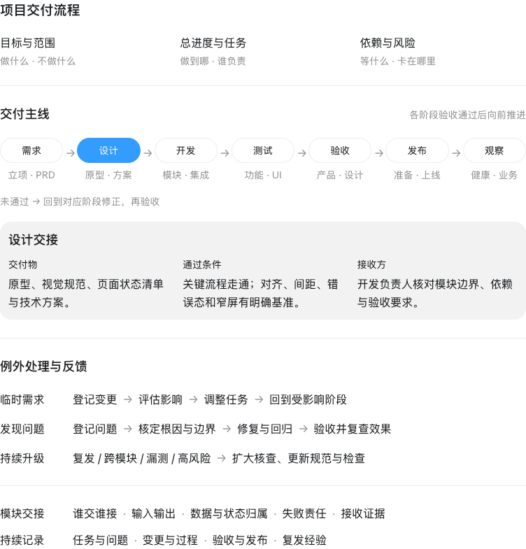

# AI Project OS 研发管理与交付流程图

更新：2026-11-02；T-030 / C-012 / E-019。当前为第二版，已替代连线过密的第一版；旧图保留于[历史图源](evidence/flow-architecture-v1-20261102.mmd)。

[打开交互版](assets/delivery-workflow.html)：选择阶段查看交付物、通过条件和接收方。[可编辑图源](assets/delivery-workflow.fragment.html)随本仓库保存，交互版包含预览所需样式和运行框架，不依赖临时工作区。

主线保留七个阅读节点，对应原十阶段：需求含立项/PRD，设计含原型/技术方案，开发与测试分别展示，验收为产品/设计验收，发布含准备/上线，最后为上线观察。交接门槛没有省略；小任务不适用阶段注明原因。

| 层次 | 含义与权威来源 |
| --- | --- |
| 全程管理 | [项目总览](README.md)、[任务与问题](TASKS.md)、[变更](CHANGES.md)：目标、总进度、主责、依赖与暂停恢复点 |
| 交付主线 | [执行流程](WORKFLOW.md)、[阶段验收](ACCEPTANCE.md)、[PRD](PRD.md)、[设计基线](DESIGN.md)；未通过返回对应阶段，不默认重走全链 |
| 例外与改进 | [复发与改进](LESSONS.md)：临时需求评估后进入任务，问题经过根因/边界核定、修复/回归及效果复验；适用时升级 |
| 模块与追溯 | [模块合同](MODULE-BOUNDARIES.md)、[交接模板](TEMPLATES.md)、[日志](ACTIVITY.md)、[证据](EVIDENCE.md)：谁交谁接、输入输出、数据/状态及失败归属 |

发布仍遵循[现行发布规则](../production-release.md)，用户发起既有 Workflow。已有授权内的常规工作继续推进；不增加逐阶段用户审批。图是流程说明，不代表自动流程已运行、业务测试通过或产品已上线。

E-019 记录本地图示的实际渲染与交互检查；E-018 只保留第一版文字/结构检查历史，已不能作为图示可读性通过的依据。后续图示交付需检查实际画面，不能只统计节点和链接。
